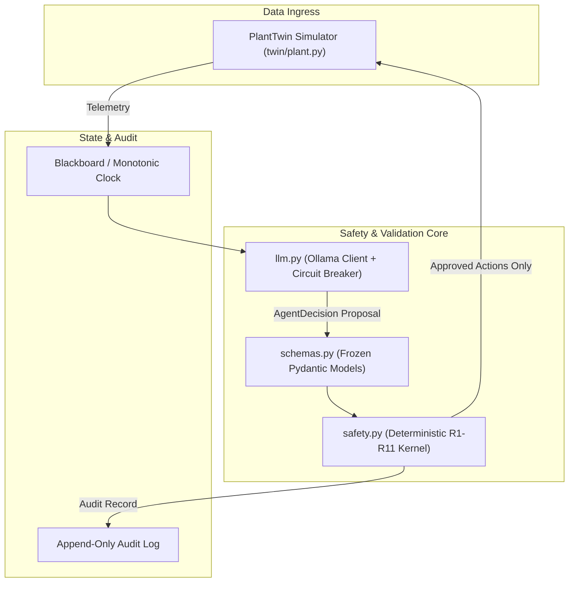

# HydroMesh

> **HydroMesh is a deterministic decision-support engine for Himalayan run-of-river hydropower plants.**  
> **It couples predictive sediment analytics to IEC 62364-style runner wear models to advise on gate modulation and desander flushing.**  
> **The LLM only proposes; a pure, fail-closed safety kernel (R1–R11) strictly governs all approvals.**

---

### Physics Honesty Note
- **Digital Twin Only**: The plant model runs against a stylized digital twin simulator, not an engineering-validated plant model.
- **IEC 62364-Style Wear**: Runner wear uses an IEC 62364-style formulation with calibrated lumped constants ($K$), *not* certified standard coefficients. No formal compliance with IEC 62364 is claimed or implied.
- **Strictly Advisory Dispatch**: Grid dispatch reallocations are hardcoded advisory recommendations (`advisory: Literal[True] = True`). The system cannot actuate physical electrical grid switchgear.
- **Fail-Closed Execution**: Ambiguous states, sensor anomalies, or rule violations strictly produce `rejected` or `needs_human`.

---

## Verification & Testing

Run the full gate suite (code style, type checking, 100% test coverage, and security analysis):

```bash
# Code style, strict typing, tests, and 100% safety kernel coverage:
make check

# Static security analysis (Bandit) and adversarial security suite:
make security

# Micro-benchmarks (validate, step, 24h simulation):
python scripts/bench.py

# Live European ECMWF Satellite & Hydrology Extraction:
python live_extraction.py
python live_extraction.py --plant upper_tamakoshi --stream
python live_extraction.py --all
```

---

## Architecture



---

## Key Invariants & Security Baseline

| Invariant | Implementation | Architectural Defense |
| :--- | :--- | :--- |
| **I1: Kernel Authority** | `hydromesh/safety.py` | Model output never reaches actuators without kernel validation |
| **I2: Advisory Dispatch** | `hydromesh/schemas.py` | `ReallocateDispatch.advisory` hardcoded to `Literal[True]` |
| **I3: Fail Closed** | `hydromesh/safety.py` | On doubt, violation, or sensor stall -> `rejected` or `needs_human` |
| **F1: Deterministic Confidence** | `hydromesh/safety.py` | `effective_confidence = min(llm_confidence, deterministic_confidence)` |
| **F2: Schema Bounds** | `hydromesh/schemas.py` | Strict `max_length`, regex ID patterns, `allow_inf_nan=False` |
| **F3: Atomic Re-validation** | `hydromesh/twin/plant.py` | `PlantTwin.apply()` re-validates fresh snapshot before actuation (TOCTOU defense) |
| **F5: Host Allowlist (SSRF)** | `hydromesh/llm.py` | Ollama host strictly restricted to loopback allowlist; bans cloud metadata IPs |
| **F6: Log Redaction** | `hydromesh/logging.py` | Redacts sensitive credentials and sanitizes CR/LF log injection |

---

## Verification & Environment Reference

All components run with zero external cloud dependencies using local environment configurations:

```bash
# Verify end-to-end Sprint 4 stack:
python scripts/verify_sprint4.py

# Live Nepal Hydrology & Weather extraction:
python live_extraction.py
```

Key environment configuration variables in `.env` (or system environment):
- `HYDROMESH_ENV`: `production` / `staging` / `development` (default: `development`)
- `HYDROMESH_OLLAMA_HOST`: Loopback Ollama endpoint (default: `http://127.0.0.1:11434`)
- `HYDROMESH_SECRET_KEY`: High-entropy secret for Argon2id and JWT signing
- `HYDROMESH_INSPECTION_MODE`: Enable/disable synthetic telemetry perturbation

---

## Documentation

- [docs/THREATS.md](file:///C:/Users/user/Documents/HydroMesh/docs/THREATS.md) — Comprehensive Threat Model & Security Architecture Baseline (STRIDE, OWASP Top 10, F1–F8 Action Plan)
- [SAFETY.md](file:///C:/Users/user/Documents/HydroMesh/SAFETY.md) — Deterministic safety rules R1–R11 specification
- [DEMO.md](file:///C:/Users/user/Documents/HydroMesh/DEMO.md) — Interactive scenario walkthrough
- [HYDROMESH_BUILD_PLAN.md](file:///C:/Users/user/Documents/HydroMesh/HYDROMESH_BUILD_PLAN.md) — Master implementation schedule

