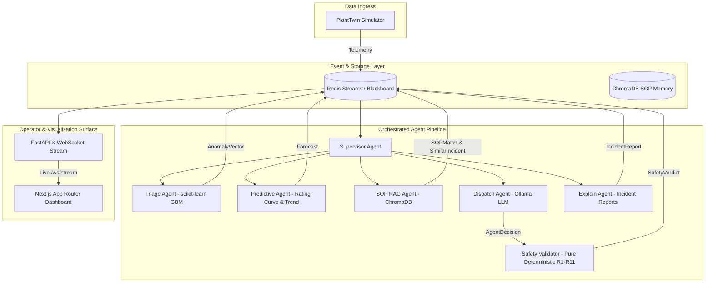

# HydroMesh

> **Self-hosted, spatio-temporal deep-learning platform for Himalayan run-of-river hydropower plants.**
> It forecasts suspended sediment (PPM) and river discharge 12–24 h ahead, couples those forecasts to IEC 62364 turbine wear physics, and surfaces automated 3-tier operational alerts — replacing a reactive overhaul cycle that costs up to NPR 80 Lakhs per monsoon season.

---

### Honesty Guardrails & Operational Scope
- **Digital Twin Only**: The MVP runs strictly against a stylized digital twin simulator, not an engineering-validated plant model.
- **Simulated Metrics**: All impact calculations, monetary savings, and wear reductions are simulated.
- **Advisory Dispatch**: Advisory actions never auto-actuate physical plant valves or governors. All outputs require human operator approval or acknowledgement.

---

## Architecture



---

## 3-Tier Alert System & IEC 62364 Wear Physics

IEC 62364 Erosion Formula:
$$\Delta W = 10^{-9} \cdot K_m \cdot C \cdot (W_{\text{rel}})^{2.5} \cdot K_{\text{hardness}}$$

| Status | PPM Range | Action |
| :--- | :--- | :--- |
| **GREEN** | < 1,200 | Normal generation |
| **YELLOW** | 1,200 – 3,000 | Advisory: Open desander sluice gates for controlled flushing |
| **RED** | > 3,000 | Alert-only; 10-minute operator ACK window before shutdown recommendation |

---

## Quickstart

```bash
# 1. Configure environment
cp .env.example .env

# 2. Seed models and synthetic SOP corpus
make seed

# 3. Start demo services (Redis, API, Web)
make demo
```

---

## Baseline Evaluation (Simulated)

> [!NOTE]
> Evaluation results comparing standard reactive scheduling vs HydroMesh advisory forecasting across 100 simulated monsoon days will be populated during milestone T18.

| Metric | Baseline (Reactive) | HydroMesh (Advisory) | Improvement |
| :--- | :--- | :--- | :--- |
| Runner Wear (mm/season) | *Pending T18* | *Pending T18* | *Pending T18* |
| Generation Loss (MWh) | *Pending T18* | *Pending T18* | *Pending T18* |
| Unscheduled Outages | *Pending T18* | *Pending T18* | *Pending T18* |

---

## Documentation & Safety

- [SAFETY.md](file:///C:/Users/user/Documents/HydroMesh/SAFETY.md) - R1–R11 safety rules, fail-closed policy, and advisory guardrails
- [DEMO.md](file:///C:/Users/user/Documents/HydroMesh/DEMO.md) - 3-minute interactive scenario walkthrough
- [BUILD_PLAN.md](file:///C:/Users/user/Documents/HydroMesh/HYDROMESH_BUILD_PLAN.md) - Full engineering specification and implementation plan
