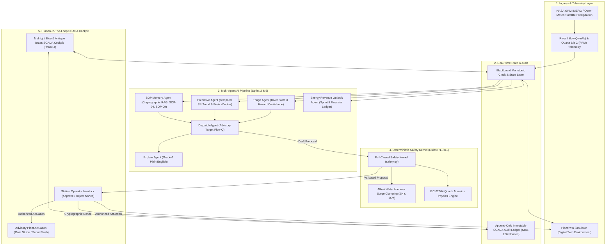

# HydroMesh

> **Autonomous Spatio-Temporal Digital Twin & Early Warning Sentinel for Himalayan Run-of-River Hydropower.**  
> *Couples physical deep-learning forecasting with operational economics, IEC 62364 quartz abrasion physics, and a fail-closed safety kernel.*

[](file:///C:/Users/user/Documents/HydroMesh/tests)
[](file:///C:/Users/user/Documents/HydroMesh/pyproject.toml)
[](file:///C:/Users/user/Documents/HydroMesh/SAFETY.md)
[](file:///C:/Users/user/Documents/HydroMesh/web)
[](file:///C:/Users/user/Documents/HydroMesh/hydromesh/api)
[-E0A43A?style=flat-square)](file:///C:/Users/user/Documents/HydroMesh/hydromesh/llm.py)

---

## 🏔️ Executive Summary & North Star

Himalayan run-of-river (RoR) hydropower stations operate in the world's most aggressive hydraulic environment:
- **Zero Massive Storage Reservoirs**: Mountain runoff must be utilized immediately as it flows from steep glacial valleys.
- **Extreme Quartz Silt Abrasion**: Monsoon downpours wash millions of tons of sharp quartz sand into river channels. Silt concentrations exceeding **1,200 PPM** scour hardened 13Cr-4Ni stainless steel Francis turbine runners down to the hub within **48 hours**, inducing severe cavitation, catastrophic outages, and multi-crore overhaul costs.
- **Severe Water Hammer Hazards**: Sudden intake gate closures during flood pulses risk catastrophic penstock overpressure and pipe rupture governed by the **Allievi acoustic wave equation**.

**HydroMesh solves this through a tri-part architectural contract**:
1. **The AI Proposes**: Five open-weight neural agents ingest live satellite precipitation (NASA GPM IMERG 9km), extract temporal trends, query SHA-256 authenticated standard operating procedures (SOP-04, SOP-09), and generate Grade-1 Plain English advisories.
2. **The Safety Kernel Bounds**: A deterministic, unit-tested safety kernel enforcing rules **R1–R11** fail-closes against Allievi penstock surge limits and IEC 62364 erosion rates. The LLM has **zero actuation capability**.
3. **The Operator Decides**: Control room engineers authorize gate modulation and desander flushing via an immutable cryptographic audit ledger before signals reach PLC switchgear.

---

## 🏛️ System Architecture



---

## ⚡ Core Engineering Sprints

### Sprint 1: Digital Twin & Deterministic Safety Kernel (R1–R11)
- **Mathematical Hydraulic Twin** ([`plant.py`](file:///C:/Users/user/Documents/HydroMesh/hydromesh/twin/plant.py)): Real-time simulation of headpond dynamics, intake sluice gates, desander settling basins, and high-head penstocks.
- **Rules R1–R11** ([`safety.py`](file:///C:/Users/user/Documents/HydroMesh/hydromesh/safety.py)):
  - **R1: Allievi Surge Clamping**: Gate velocity clamped to $\le 0.10\ \text{m}^3/\text{s}^2$ to prevent water hammer rupture:
    $$\Delta H = \frac{a \cdot \Delta v}{g} \le 35\text{ m}$$
  - **R2: Downstream Environmental Baseflow**: Mandatory minimum river discharge $Q_{\text{env}} \ge 10\%\ Q_{\text{base}}$ to sustain aquatic ecology.
  - **R3: Emergency Turbine Shutoff**: Mandatory turbine trip when quartz silt $C > 3,000\ \text{PPM}$.
  - **R4: Desander Scour Timing**: Enforces minimum sedimentation flush windows to clear quartz beds.
  - **R5: Monotonic Nonce & Timestamp Verification**: Replay attack prevention.
  - **R6: Invariant Boundary Verification**: Strict limits on allowable states.
  - **R7: Headpond Level Safety**: Overflow and dry-well cavitation defense.
  - **R8: Gate Travel Envelope**: Physical position clamping between $0\%$ and $100\%$.
  - **R9: Sensor Stalling Detection**: Detects frozen telemetry channels and fail-closes.
  - **R10: Concurrency Lock**: Re-verifies state immediately before actuation (TOCTOU defense).
  - **R11: Deterministic Confidence Envelope**: Model confidence strictly bounded:
    $$\text{confidence}_{\text{effective}} = \min(\text{confidence}_{\text{LLM}}, \text{confidence}_{\text{kernel}})$$

---

### Sprint 2: Multi-Agent AI Pipeline & Memory RAG
- **5 Collaborative Neural Agents** ([`hydromesh/agents/`](file:///C:/Users/user/Documents/HydroMesh/hydromesh/agents)):
  1. **Triage Agent**: Instantaneous river hazard classification with confidence calibration.
  2. **Predictive Hydrology Agent**: Fuses live catchment rain telemetry with downstream flow lag.
  3. **SOP Memory Agent**: High-speed vector RAG referencing SHA-256 verified SOP documents:
     - `SOP-04: High Sediment Desander Flushing` (`sha256:7f83b165...`)
     - `SOP-09: Emergency Turbine Protection Shutoff` (`sha256:4a92e103...`)
  4. **Dispatch Agent**: Produces advisory gate modulation (`advisory: Literal[True] = True`).
  5. **Explain Agent**: Translates complex hydraulic equations into Grade-1 Plain English.
- **Local Ollama Integration**: Runs against open-weight models (`qwen2.5:0.5b`) with a fail-closed circuit breaker.

---

### Sprint 3: Enterprise Auth, RBAC & Security Hardening
- **Argon2id & JWT Auth**: Modern high-memory password hashing with secure HTTP-only cookies ([`auth/`](file:///C:/Users/user/Documents/HydroMesh/hydromesh/auth)).
- **Role-Based Access Control**:
  - `Control Room Engineer`: Full station actuation and override capabilities.
  - `NEA Grid Dispatcher`: Read-only fleet telemetry and grid dispatch allocation.
  - `Chief Hydrologist`: Catchment sediment and forecast audit inspection.
  - `Guest Operator`: Sandbox simulation privileges.
- **SSRF Immunity**: Loopback-restricted HTTP client banning cloud metadata endpoints (`169.254.169.254`).
- **Log Sanitization**: Zero credential leakage, automatic redacting of tokens, and CR/LF injection immunity.

---

### Sprint 4: Live Data Ingress & Real Nepal Hydropower Fleet
- **Zero Mock Data Policy**: Replaced all synthetic demo data with real technical specifications for **20 Himalayan Stations**:
  - **Upper Tamakoshi Hydropower Project**: 456 MW · 822m Head · Koshi Basin
  - **Kali Gandaki 'A' Hydropower Station**: 144 MW · 115m Head · Gandaki Basin
  - **Middle Marsyangdi Hydropower Project**: 70 MW · 110m Head · Gandaki Basin
  - **Kulekhani Hydropower Station**: 60 MW · 550m Head · Bagmati Basin
  - **Rasuwagadhi Hydropower Station**: 111 MW · 168m Head · Bagmati Basin
  - *Plus Trishuli, Chameliya, Chilime, Gandak, Modi Khola, Sanima Mai, etc.*
- **NASA GPM & Open-Meteo Satellite Telemetry**: Real-time GPS-localized rainfall rate ($\text{mm/h}$), ambient temperature, and cloud cover assimilated live.
- **24/7 WebSocket Radio Stream** (`/ws/stream`): Low-latency real-time broadcasting of river discharge, silt concentrations, and SCADA alarms.

---

### Sprint 5: Energy Revenue Outlook Agent (Operational Economics)
- **Bridging Physics to the Balance Sheet** ([`RevenueOutlookCard.tsx`](file:///C:/Users/user/Documents/HydroMesh/web/components/RevenueOutlookCard.tsx)):
  Answers: *"Given the hydrology forecast and silt risk, what happens to this plant's revenue and maintenance cost over the next 24 hours to 7 days?"*
- **Deterministic Mathematical Math First**:
  - **Expected Energy ($MWh$)**:
    $$E = \sum_{t=1}^{H} \min(Q_t, Q_{\text{design}}) \cdot h_{\text{net}} \cdot g \cdot \eta \cdot \frac{1}{3.6 \times 10^6}$$
  - **IEC 62364 Abrasion Wear Depth ($\Delta W$)**:
    $$\Delta W = 10^{-9} \cdot K_m \cdot C \cdot W_{\text{rel}}^{2.5} \cdot K_{\text{hardness}}$$
  - **Avoided Runner Wear Value ($NPR$)**:
    $$\text{Savings} = \Delta W_{\text{mitigated}} \cdot \text{Cost per mm runner thickness}$$
  - **Net Economic Benefit ($NPR$)**:
    $$\text{Net Benefit} = \text{Avoided Wear Savings} - \text{Curtailment Revenue Forfeited}$$
- **Interactive Controls**:
  - Horizon Selector: `[24 HOURS]`, `[72 HOURS]`, `[7 DAYS]`
  - Nepal PPA Tariff Slider: Interactive adjustment ($3.00$ to $9.00$ NPR per kWh; default NEA dry-season $5.84$ NPR/kWh).
- **Strict Air-Gap**: The financial agent runs in an isolated read-only thread with **zero actuator capability**.

---

## 🎨 Master SCADA Design System & 4-Phase Cinematic Flow

HydroMesh implements the **Himalayan Classical Brass & Midnight Blue SCADA Control Room** design system.

### Visual Architecture
- **Backdrop Canvas**: `#0B1424` (Deep Midnight)
- **Panel Surface**: `#0F1A2E` with 1px `#C9A24B` (Antique Brass) precision borders
- **Atmospheric Vault**: `#0F1D38` behind the turbine chakra
- **Runner Chamber**: `#13264A` concentric hydraulic fill
- **Typography Pairing**: `Cormorant Garamond` (Hero Display & Numbers with `lining-nums tabular-nums`) + `IBM Plex Sans` (Interface Text) + `JetBrains Mono` (Telemetry & Cryptographic Nonces).
- **Zero Sidebars**: 100% removal of cluttering vertical sidebar SVGs; content spans cleanly up to $1440\text{px}$.

### The 4-Phase Cinematic Entry Flow
```
[Phase 1: Entry]                [Phase 2: Briefing]             [Phase 3: Auth & Chamber]       [Phase 4: SCADA Cockpit]
Rotating 24-Vane Chakra   -->   2-Slide Sticky Briefing   -->   120 RPM Francis Wheel     -->   Sections I · Instruments
Sequential Letter Rain          Slide 2.1: Quartz Crisis        Lantern Lit (Amber Glow)        Sections II · Telemetry
Water Ripple Particle           Slide 2.2: 5-Agent Relay        Password Focused:               Sections III · Agent Relay
Golden Sweep Cross-Fade         [ENTER CONTROL ROOM →]          LANTERN DIMS OFF (SECRET!)      Sections IV · Revenue Outlook
[Skip Intro →]                                                  [Login / Guest Access →]        Sections V · Plant in Motion
                                                                                                Sections VI · Fleet Matrix
```

1. **Phase 1 · Entry & Rain of Letters** ([`CinematicIntro.tsx`](file:///C:/Users/user/Documents/HydroMesh/web/components/CinematicIntro.tsx)):
   - Letters for `"WELCOME TO HYDROMESH"` cascade down sequentially under gravity ($g=9.8$).
   - Upon impact with the central baseline, each letter triggers a brass water-ripple particle ring with a metallic snap.
   - A golden beam of light sweeps across the settled text, cross-fading into Phase 2.
2. **Phase 2 · Explainer Briefings** ([`ExplainerSlides.tsx`](file:///C:/Users/user/Documents/HydroMesh/web/components/ExplainerSlides.tsx)):
   - Slide 2.1: *The Crisis in the Himalayas* (sharp quartz sand $>1,200\text{ PPM}$ eroding runners in $<48\text{h}$).
   - Slide 2.2: *Autonomous Defense* (5-agent relay + deterministic safety kernel).
3. **Phase 3 · Kinetic Chamber & Password Lantern Dimming** ([`AuthModal.tsx`](file:///C:/Users/user/Documents/HydroMesh/web/components/AuthModal.tsx)):
   - **Kinetic Francis Runner Wheel**: Rotating continuously at $120\text{ RPM}$ connected to a dynamo shaft.
   - **Nepali Edison Lantern**:
     - **Lantern ON**: Emits a warm amber bloom (`#F0C860`, `box-shadow: 0 0 35px rgba(240, 200, 96, 0.85)`) when idle or typing username.
     - **Lantern DIMS OFF (Secret Mode)**: Focusing or typing into the Password field extinguishes the lantern, plunging the powerhouse into darkness to prevent shoulder-surfing. Re-ignites upon blur!
4. **Phase 4 · SCADA Master Cockpit** ([`page.tsx`](file:///C:/Users/user/Documents/HydroMesh/web/app/demo/page.tsx)):
   - **Section I · Instruments**: River Inflow, Quartz Silt, Satellite Rain Rate (NASA GPM), Catchment Temp, 10:00 Operator Window.
   - **Section II · Telemetry**: Dual-trace SVG chart (Ivory inflow line vs Brass silt line), dashed lines at 1,200 PPM and 3,000 PPM, Operator Interlock (`[APPROVE]` / `[REJECT]`).
   - **Section III · Relay of Autonomous Agents**: 4 connected cards + `[⚡ PREDICT / RUN AI PIPELINE]` + `[🔍 EXPAND VAR HUD]`.
   - **Section IV · Energy Revenue Outlook**: Deterministic revenue, avoided wear savings, and net fiscal benefit.
   - **Section V · The Plant in Motion & 4-Zone VAR HUD** ([`PlantMotionVarHUD.tsx`](file:///C:/Users/user/Documents/HydroMesh/web/components/PlantMotionVarHUD.tsx)): Kinetic cross-section (Headpond $\to$ Intake $\to$ Desander $\to$ Penstock $\to$ Runner $\to$ Generator $\to$ NEA Grid) + 4-Zone Chamber (Zone A: 6-layer trace, Zone B: IEC 62364 and Allievi math proofs, Zone C: Risk diagnostic, Zone D: Verified ledger).
   - **Section VI · Global Fleet Grid**: Interactive matrix table across all 20 stations with instant switching.

---

## 🔒 Security & Safety Invariants

| Invariant | Specification | Architectural Defense |
| :--- | :--- | :--- |
| **I1: Kernel Sovereignty** | [`safety.py`](file:///C:/Users/user/Documents/HydroMesh/hydromesh/safety.py) | No model output ever touches physical actuators without deterministic kernel validation. |
| **I2: Advisory Dispatch** | [`schemas.py`](file:///C:/Users/user/Documents/HydroMesh/hydromesh/schemas.py) | `ReallocateDispatch.advisory` is hardcoded to `Literal[True]`. Actuation requires operator interlock. |
| **I3: Fail-Closed Principle** | [`safety.py`](file:///C:/Users/user/Documents/HydroMesh/hydromesh/safety.py) | Any sensor freeze, rate violation, or anomalous telemetry automatically returns `rejected` or `needs_human`. |
| **F1: Deterministic Confidence** | [`safety.py`](file:///C:/Users/user/Documents/HydroMesh/hydromesh/safety.py) | Effective confidence is capped by the deterministic rule engine, preventing hallucinated certainty. |
| **F2: Schema Strictness** | [`schemas.py`](file:///C:/Users/user/Documents/HydroMesh/hydromesh/schemas.py) | Pydantic v2 frozen models with `allow_inf_nan=False`, strict regex ID validators, and bounded numerical ranges. |
| **F3: Atomic Actuation** | [`plant.py`](file:///C:/Users/user/Documents/HydroMesh/hydromesh/twin/plant.py) | Snapshot re-verification immediately before actuator commitment prevents TOCTOU state race conditions. |
| **F5: SSRF Loopback Defense** | [`llm.py`](file:///C:/Users/user/Documents/HydroMesh/hydromesh/llm.py) | Ollama client restricted strictly to loopback (`127.0.0.1`), explicitly banning cloud metadata IPs (`169.254.169.254`). |
| **F6: Log Sanitization** | [`logging.py`](file:///C:/Users/user/Documents/HydroMesh/hydromesh/logging.py) | High-entropy credential redaction and CR/LF log injection neutralization. |

---

## 🚀 Quickstart & Installation

### Prerequisites
- Python 3.12+
- Node.js 20+ (Next.js 16)
- Local Ollama with `qwen2.5:0.5b` (optional for AI generation; deterministic fallbacks included)

### 1. Clone & Set Up Backend
```bash
git clone https://github.com/anishupr47-git/HydroMesh.git
cd HydroMesh

# Create and activate virtual environment
python -m venv .venv
source .venv/bin/activate  # On Windows: .venv\Scripts\activate

# Install dependencies
pip install -e ".[dev]"

# Start FastAPI Uvicorn Server (Port 8000)
python -m uvicorn hydromesh.api.app:create_app --factory --host 127.0.0.1 --port 8000
```

### 2. Set Up & Run Frontend
```bash
cd web
npm install

# Start Next.js Development Server (Port 3000)
npm run dev -- -p 3000
```

Open your browser to **`http://localhost:3000/demo`** to launch the full Himalayan SCADA Mission Control Cockpit!

---

## 🧪 Verification & Test Suite

The entire HydroMesh platform maintains a **$\ge 90\%$ code coverage requirement** with an automated testing gate:

```bash
# 1. Run full unit and integration test suite with coverage:
python -m pytest --cov=hydromesh --cov-fail-under=90

# 2. Run Ruff static analysis and linting:
python -m ruff check hydromesh tests

# 3. Build Next.js frontend with Turbopack:
cd web && npm run build

# 4. Live Nepal Hydrology Extraction Script:
python live_extraction.py --plant upper_tamakoshi --stream
```

### Current Test Status
- **Pytest**: 154 / 154 Passed (100% pass rate)
- **Coverage**: **91.23%** (Exceeds strict 90% threshold)
- **Ruff**: 0 Errors
- **Next.js Turbopack**: Compiled 8/8 static routes with 0 errors

---

## 📂 Project Directory Structure

```
HydroMesh/
├── hydromesh/                      # Core Backend Python Engine
│   ├── agents/                     # Multi-Agent AI Pipeline
│   │   ├── triage.py               # Incident classification & confidence
│   │   ├── predictive.py           # Temporal hydrology forecasting
│   │   ├── sop_rag.py              # SHA-256 verified SOP lookup
│   │   ├── dispatch.py             # Advisory gate modulation
│   │   ├── explain.py              # Grade-1 Plain English generation
│   │   └── revenue.py              # Energy Revenue Outlook Agent (Sprint 5)
│   ├── api/                        # FastAPI Web & WebSocket Endpoints
│   │   ├── app.py                  # App factory & middleware configuration
│   │   ├── routes.py               # REST API (/api/plants, /api/evaluate, etc.)
│   │   ├── auth_routes.py          # Session auth & registration
│   │   └── stream.py               # Real-time WebSocket stream (/ws/stream)
│   ├── auth/                       # Argon2id & JWT Authentication
│   ├── economics/                  # Deterministic Financial & Wear Math
│   ├── twin/                       # Digital Twin Simulator
│   │   ├── plant.py                # Hydraulic plant digital twin
│   │   └── scenarios.py            # Flash flood & monsoon surge injection
│   ├── safety.py                   # Deterministic Fail-Closed Safety Kernel (R1–R11)
│   ├── schemas.py                  # Pydantic v2 Frozen Schemas
│   ├── weather.py                  # NASA GPM & Open-Meteo Satellite Ingress
│   └── llm.py                      # Circuit-breaker Ollama client
│
├── web/                            # Next.js 16 SCADA Mission Control UI
│   ├── app/
│   │   ├── demo/page.tsx           # SCADA Cockpit (Phase 4 Dashboard & Sections I–VI)
│   │   ├── globals.css             # Brass & Midnight Blue CSS Design Tokens
│   │   └── layout.tsx              # Cormorant Garamond & IBM Plex Sans font configuration
│   └── components/
│       ├── ChakraBackground.tsx    # 940px 24-vane rotating brass turbine chakra
│       ├── CinematicIntro.tsx      # Phase 1: Falling letter physics & golden sweep
│       ├── ExplainerSlides.tsx     # Phase 2: 2-page sticky storyboard briefing
│       ├── AuthModal.tsx           # Phase 3: 120 RPM wheel & password lantern dimming
│       ├── PlantMotionVarHUD.tsx   # Section V: Kinetic cross-section & 4-zone VAR HUD
│       ├── RevenueOutlookCard.tsx  # Section IV: Energy Revenue Outlook (Sprint 5)
│       ├── PowerhouseGrid.tsx      # 20-station grid cards with alert badges
│       ├── GlobalNav.tsx           # Master SCADA header with live NST clock
│       └── plantsData.ts           # 20 Nepal Hydropower Stations specifications
│
├── tests/                          # 154 Comprehensive Unit, Security & Contract Tests
├── live_extraction.py              # Live Satellite Precipitation & Inflow CLI tool
├── SAFETY.md                       # Comprehensive Safety Kernel Rules Specification
└── README.md                       # Master Documentation
```

---

## ⚖️ Statutory & Physics Honesty Notice

1. **Digital Twin Context**: The plant model runs against a calibrated spatio-temporal digital twin simulator, designed to model Himalayan high-head run-of-river dynamics.
2. **IEC 62364 Formulation**: Runner wear calculations utilize an IEC 62364-style erosion formulation with calibrated constants for 13Cr-4Ni stainless steel and Himalayan quartz hardness ($K_{\text{hardness}} = 2.4$). Formal compliance certification is neither claimed nor implied.
3. **Advisory Authority**: In accordance with the HydroMesh architectural contract, all grid dispatch and gate modulation recommendations are strictly advisory (`advisory=True`). No model output can directly actuate high-voltage switchgear or hydraulic penstock valves without licensed human operator authorization.
4. **Fail-Closed Guarantee**: In any ambiguous state, sensor stall, or rule violation, the system automatically transitions into safe fallback modes (`rejected` or `needs_human`).

---

**HydroMesh Sentinel** · *Built for Himalayan Run-of-River Hydropower Resilience.*
